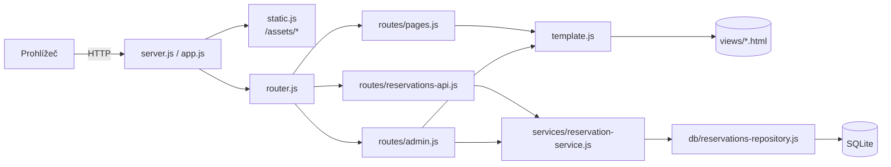

# Kavárna Holubník


## 1. Cíl a rozsah

Vytváříme ukázkovou aplikaci pro školení task managementu. Má být jednoduchá, ale realistická a rozdělená do více souborů. Zároveň v ní má zůstat prostor pro další vylepšení (viz kapitola 15).

- **Veřejný web:** one-page prezentace fiktivní kavárny v Praze se scrollováním mezi sekcemi.
- **Rezervace:** samostatná stránka, kde host vybere den a volný hodinový čas a vyplní jméno a telefon.
- **Administrace:** sekce `/admin` chráněná heslem. Zobrazí seznam rezervací a umožní je smazat.

## 2. Klíčová rozhodnutí

| Oblast | Rozhodnutí |
|---|---|
| Běh aplikace | Node.js server (`node:http`). Veřejná část je převážně statická, server navíc skládá HTML a ukládá data. |
| Jazyk | Čistý JavaScript (ES moduly), bez TypeScriptu a bez build kroku. |
| Závislosti | Žádný framework ani balíček. SQLite přes vestavěný `node:sqlite`, testy přes `node --test`. |
| Databáze | SQLite v jednom souboru `data/kavarna.sqlite`, schéma se vytvoří při startu. |
| Skládání HTML | Na serveru vlastním mini šablonovacím enginem (includes a proměnné). |
| Konfigurace | `src/config.js`, včetně hesla do adminu. Pro demo je to záměrně zjednodušené. |
| Obrázky | Fotky vygenerované AI, uložené v `src/assets/images`. |
| Písma | Hostovaná lokálně (OFL licence), web tedy nepotřebuje externí CDN. |
| Jazyk obsahu | Web je česky. Kód je anglicky, komentáře v kódu česky. |
| Požadavek na Node | Node.js ≥ 22.13 (od této verze funguje `node:sqlite` bez přepínače), doporučeno Node 24 LTS. |
| Struktura | Celý web je v `src`, statické soubory včetně obrázků v `src/assets`. Databáze (`data/`) a testy (`tests/`) jsou mimo `src`. |
| CSS | `styles.css` pro veřejný web a samostatný `admin.css` pro administraci. |
| Přihlášení do adminu | Formulář s heslem a session cookie, s možností odhlášení. |

## 3. Architektura



Zpracování požadavku:

1. Pokud cesta začíná `/assets/`, odpoví `static.js` souborem ze `src/assets`.
2. Jinak hledá `router.js` shodu metody a cesty a zavolá handler.
3. Handler stránky připraví data a zavolá `render()`. Engine složí stránku z fragmentů a vloží ji do layoutu.
4. API handler vrací JSON. Byznys pravidla řeší výhradně `reservation-service.js`.
5. Když se nic nenajde, vrátí se stránka 404. Neošetřená chyba vrátí stránku 500 a zapíše se do konzole.

Vrstvy jsou oddělené takto: HTML (`views`), HTTP (`lib`, `routes`), pravidla (`services`), SQL (`db`) a kód pro prohlížeč (`assets/js`).

## 4. Struktura projektu

```
demo/
├── README.md                     # stručný popis aplikace a spuštění
├── DECISIONS.md                  # zásadní rozhodnutí
├── package.json                  # pouze skripty, bez závislostí
├── .gitignore                    # data/*.sqlite*, node_modules, .DS_Store
├── data/                         # SQLite databáze (vzniká za běhu, není v gitu)
├── docs/
│   ├── PRD.md
│   └── PLAN.md
├── tests/
│   ├── template.test.js
│   └── reservation-service.test.js
└── src/
    ├── config.js                 # veškerá konfigurace včetně hesla
    ├── server.js                 # start: config, TZ, DB, listen
    ├── app.js                    # hlavní handler: static → router → 404/500
    ├── lib/
    │   ├── router.js             # tabulka rout, parametry :id
    │   ├── template.js           # šablonovací engine
    │   ├── static.js             # statické soubory + MIME typy
    │   ├── http.js               # čtení těla, odpovědi (html/json/redirect), cookies
    │   ├── session.js            # přihlášení do adminu (in-memory)
    │   └── dates.js              # práce s daty a české formátování
    ├── db/
    │   ├── database.js           # otevření DB, PRAGMA, aplikace schema.sql
    │   ├── schema.sql
    │   ├── reservations-repository.js  # jediné místo s SQL dotazy
    │   └── seed.js               # ukázková data (npm run db:seed)
    ├── services/
    │   └── reservation-service.js     # sloty, kapacita, validace
    ├── routes/
    │   ├── pages.js              # GET / a GET /rezervace
    │   ├── reservations-api.js   # /api/slots, /api/reservations
    │   └── admin.js              # /admin/*
    ├── views/
    │   ├── layouts/
    │   │   ├── main.html         # veřejný layout
    │   │   └── admin.html        # layout administrace
    │   ├── partials/
    │   │   ├── head.html         # obsah <head> webu: meta, fonty, styles.css, favicon
    │   │   ├── header.html       # logo + navigace + CTA
    │   │   ├── footer.html
    │   │   ├── day-option.html   # jedna volba dne ve formuláři
    │   │   └── admin-row.html    # jeden řádek tabulky rezervací
    │   ├── sections/             # sekce one-page
    │   │   ├── hero.html
    │   │   ├── about.html
    │   │   ├── menu.html
    │   │   ├── gallery.html
    │   │   ├── visit.html        # otevírací doba, adresa, kontakt
    │   │   └── reservation-cta.html
    │   └── pages/
    │       ├── home.html         # skládá sekce
    │       ├── reservation.html
    │       ├── not-found.html
    │       ├── error.html
    │       └── admin/
    │           ├── login.html
    │           └── reservations.html
    └── assets/
        ├── css/
        │   ├── styles.css        # veřejný web
        │   └── admin.css         # administrace
        ├── js/
        │   ├── main.js           # navigace, mobilní menu, aktivní sekce
        │   ├── reservation.js    # načítání slotů a odeslání rezervace
        │   └── admin.js          # potvrzení smazání
        ├── fonts/                # woff2
        └── images/               # fotky (jpg) + logo/favicon (svg)
```

`src` obsahuje celý web. Databáze a testy do webu nepatří, proto jsou záměrně v kořeni projektu (`data/`, `tests/`).

## 5. Konfigurace (`src/config.js`)

Konfigurace je ES modul, aby mohla obsahovat české komentáře. Relativní cesty se počítají od kořene projektu.

```js
export default {
  server: { host: 'localhost', port: 3004 },
  timezone: 'Europe/Prague',
  cafe: {
    name: 'Kavárna Holubník',
    tagline: 'Výběrová káva a domácí pečivo na Vinohradech',
    street: 'Holubí 12',
    city: '120 00 Praha 2 – Vinohrady',
    phone: '+420 777 123 456',
    email: 'ahoj@kavarnaholubnik.cz',
    instagram: 'https://instagram.com/kavarnaholubnik'
  },
  openingHours: { open: 13, close: 20 },
  reservations: { capacityPerSlot: 5, daysAhead: 14 },
  admin: { password: 'holubnik2026', sessionTtlMinutes: 120 },
  database: { file: 'data/kavarna.sqlite' }
};
```

- Název, adresa a kontakty kavárny jsou fiktivní a do šablon se dostávají jako proměnné (`{{ cafe.name }}`).
- `server.js` hned na začátku nastaví `process.env.TZ = config.timezone`, takže všechna data a časy jsou v pražském čase.

## 6. Šablonovací engine (`src/lib/template.js`)

Engine je záměrně malý. Umí jen tři konstrukce:

| Syntaxe | Význam |
|---|---|
| `{{> sections/hero }}` | Vloží fragment `src/views/sections/hero.html`. Funguje i vnořeně. |
| `{{ cafe.name }}` | Vloží hodnotu z kontextu (tečková notace) a **escapuje HTML**. |
| `{{{ content }}}` | Vloží hodnotu bez escapování. Jen pro HTML, které vyrobil server. |

API:

```js
await render('pages/home', { title: 'Úvod' }, { layout: 'layouts/main' });
await renderFragment('partials/admin-row', reservation);
```

Pravidla:

- Kontext vždy obsahuje globální data `cafe`, `openingHours`, `year` a `currentPath`. Data handleru je doplní nebo přepíšou.
- Layout dostane vyrenderovanou stránku jako `{{{ content }}}`.
- Engine nemá cykly ani podmínky. Seznamy vyrenderuje handler přes `renderFragment()` pro každou položku, výsledky spojí a předá jako raw proměnnou (např. `{{{ rows }}}`).
- Název fragmentu musí odpovídat `^[a-z0-9/-]+$`. Výsledná cesta musí ležet uvnitř `src/views`, což chrání před path traversal.
- Hloubka vnoření je omezená na 10 kvůli cyklům. Chybějící fragment vyhodí chybu se jménem souboru.
- Chybějící proměnná se vyrenderuje jako prázdný řetězec.
- Šablony se čtou z disku při každém požadavku, takže úpravy jsou vidět hned bez restartu. Cache je možné vylepšení.

## 7. HTTP vrstva

### Routy

| Metoda | Cesta | Popis | Odpověď |
|---|---|---|---|
| GET | `/` | One-page web | HTML |
| GET | `/rezervace` | Rezervační formulář | HTML |
| GET | `/api/slots?date=YYYY-MM-DD` | Sloty a obsazenost pro daný den | JSON |
| POST | `/api/reservations` | Vytvoření rezervace | JSON `201` / `400` / `409` |
| GET | `/admin` | Přihlášení, nebo seznam rezervací | HTML |
| POST | `/admin/login` | Přihlášení heslem | `303` na `/admin`, nebo `401` s chybou |
| POST | `/admin/logout` | Odhlášení | `303` na `/admin` |
| POST | `/admin/reservations/:id/delete` | Smazání rezervace | `303` na `/admin?deleted=1` |
| GET | `/assets/*` | Statické soubory | soubor |
| * | ostatní | Nenalezeno | HTML `404` |

### Moduly

- **`router.js`:** pole `{ method, path, handler }`, segmenty s `:param` a handler `(req, res, params)`.
- **`http.js`:**
  - `readBody()` s limitem 10 kB, umí JSON i `application/x-www-form-urlencoded`
  - `sendHtml()`, `sendJson()`, `redirect()`
  - `parseCookies()`, `setCookie()`
- **`static.js`:**
  - mapa MIME typů (css, js, jpg, png, webp, svg, woff2, ico)
  - ochrana proti `..`
  - `Cache-Control: no-cache`
- **`app.js`:** obalí každý požadavek do try/catch a loguje řádek `GET /rezervace 200 4ms`.

## 8. Datová vrstva

### Schéma (`src/db/schema.sql`)

```sql
CREATE TABLE IF NOT EXISTS reservations (
  id         INTEGER PRIMARY KEY AUTOINCREMENT,
  date       TEXT    NOT NULL,                  -- YYYY-MM-DD
  hour       INTEGER NOT NULL CHECK (hour BETWEEN 0 AND 23),
  name       TEXT    NOT NULL,
  phone      TEXT    NOT NULL,
  created_at TEXT    NOT NULL DEFAULT (datetime('now', 'localtime'))
);
CREATE INDEX IF NOT EXISTS idx_reservations_slot ON reservations (date, hour);
```

- **`database.js`:**
  - vytvoří složku `data/`
  - otevře `DatabaseSync`
  - nastaví `PRAGMA journal_mode = WAL`
  - spustí `schema.sql`
  - podporuje `:memory:` pro testy
- **`reservations-repository.js`:** jediné místo s SQL. Všechny dotazy jsou parametrizované.
  - `countBySlot(date, hour)`
  - `countsByDate(date)`, který vrací mapu hodina → počet
  - `insert({ date, hour, name, phone })`
  - `listFrom(date)`
  - `deleteById(id)`
- **`seed.js`:** vloží zhruba 20 ukázkových rezervací na nejbližší dny. Jeden slot je plně obsazený, aby šlo ukázat stav „obsazeno“.

## 9. Rezervace

### Pravidla (`reservation-service.js`)

- **Sloty:** začínají vždy v celou hodinu a trvají 1 hodinu. Při otevírací době 13–20 jde o časy **13:00 až 19:00** (7 slotů), poslední končí ve 20:00.
- **Kapacita:** nejvýše **5 rezervací** na jeden slot (`capacityPerSlot`). Rezervace odpovídá jednomu stolu, počet osob se neeviduje.
- **Rozsah:** rezervovat lze od dneška na `daysAhead` dní dopředu (14 dní včetně dneška). Dnes jen sloty, které ještě nezačaly. Kavárna má otevřeno každý den.
- **Validace:**
  - jméno po ořezání mezer 2–80 znaků
  - telefon po odstranění mezer odpovídá `^\+?\d{9,15}$` a ukládá se bez mezer
  - datum a hodina musí být v povoleném rozsahu
- **Konzistence:** kontrola kapacity a vložení proběhnou v jedné transakci (`BEGIN IMMEDIATE`). Zdrojem pravdy je server, klientská validace je jen pro pohodlí.

Veřejné funkce služby:

- `getAvailableDays(now)`
- `getSlots(date, now)`
- `createReservation(input, now)`
- `listUpcoming(now)`
- `deleteReservation(id)`

Parametr `now` umožňuje deterministické testy.

### API

`GET /api/slots?date=2026-11-05`

```json
{
  "date": "2026-11-05",
  "slots": [
    { "hour": 13, "time": "13:00", "available": 3, "bookable": true },
    { "hour": 14, "time": "14:00", "available": 0, "bookable": false }
  ]
}
```

`POST /api/reservations` s tělem `{ "date": "2026-11-05", "hour": 13, "name": "Jana Nováková", "phone": "+420 777 111 222" }`

| Výsledek | Kód | Tělo |
|---|---|---|
| vytvořeno | 201 | `{ "id": 42, "date": "2026-11-05", "time": "13:00", "dateLabel": "středa 5. 11." }` |
| nevalidní vstup | 400 | `{ "error": "validation", "fields": { "phone": "Zadejte platné telefonní číslo." } }` |
| slot je plný | 409 | `{ "error": "slot_full", "message": "Tento čas je už obsazený, vyberte prosím jiný." }` |

### Stránka `/rezervace`

1. Server vyrenderuje volby dnů jako radio „čipy“, například „Dnes“, „Pá 31. 10.“ a „So 1. 11.“. Na menších displejích se dají vodorovně posouvat.
2. `reservation.js` po výběru dne načte `/api/slots` a vykreslí časy jako radio tlačítka. U plných a už začatých časů ukáže „obsazeno“ a nedovolí je vybrat.
3. Pole jméno a telefon mají `required` a `autocomplete` (`name`, `tel`).
4. Formulář se odesílá přes `fetch`. Stavy jsou načítání, chyba u pole, plný slot (sloty se znovu načtou) a úspěch se shrnutím rezervace.
5. Výsledky oznamuje `aria-live` oblast.

## 10. Administrace

- **Přihlášení:**
  - formulář s jedním polem pro heslo
  - porovnání s `config.admin.password` přes `crypto.timingSafeEqual`
  - při chybě odpověď `401` a hláška
- **Session (`session.js`):**
  - náhodný token (`crypto.randomBytes(32)`) v paměťové mapě s expirací `sessionTtlMinutes`
  - cookie `admin_session` s nastavením `HttpOnly; SameSite=Strict; Path=/admin`
  - restart serveru uživatele odhlásí, pro demo to stačí
- **Seznam:**
  - tabulka s rezervacemi od dneška, seřazená podle data a času
  - sloupce: datum, čas, jméno, telefon, vytvořeno a akce
  - nad tabulkou je počet rezervací
  - prázdný stav „Zatím žádné rezervace“
- **Smazání:**
  - samostatný `<form method="post">` u každého řádku
  - `admin.js` doplní `confirm()` s textem „Opravdu smazat rezervaci …?“
  - po smazání přesměrování a flash hláška podle `?deleted=1`
- **Layout:** samostatný `layouts/admin.html` s vlastním `<head>`. Načítá jen `admin.css`, obsahuje `<meta name="robots" content="noindex">` a jednoduchou hlavičku (logo, „Rezervace“, Odhlásit).

## 11. Frontend a design

### Identita

- **Kavárna:** Holubník, Praha 2 – Vinohrady, fiktivní ulice Holubí 12. Specialty káva, domácí pečivo, klidné místo na práci i rande.
- **Barvy:**
  - krémová `#F6F0E8` (pozadí)
  - espresso `#2A1E17` (text)
  - terakota `#C26A3D` (akcent a CTA)
  - šalvěj `#8C9A80` (doplňková)
  - mléčná `#FFFDF9` (karty)
- **Písma:** *Fraunces* pro nadpisy a *Inter* pro text. Obě ve formátu woff2 v `assets/fonts`.
- **Logo:** jednoduché SVG (šálek s holubičkou), použité i jako favicon.

### Sekce one-page (`pages/home.html`)

1. **Header:**
   - logo vlevo
   - odkazy na sekce (O nás, Nabídka, Atmosféra, Návštěva)
   - tlačítko „Rezervovat“
   - lepí se k hornímu okraji
   - na mobilu hamburger menu
2. **Hero:** velká fotka interiéru s tmavým přechodem, název, tagline, CTA „Rezervovat stůl“ a odkaz „Prohlédnout nabídku“.
3. **O nás:** příběh kavárny ve 2–3 odstavcích, fotka baristy a tři „hodnoty“ (pražírna z Prahy, pečeme každé ráno, místo bez spěchu).
4. **Nabídka:** karty v kategoriích Káva, Ne-káva a Sladké. Položky mají ceny v Kč, například Espresso 59 Kč a Flat white 89 Kč. Obsah je statické HTML ve fragmentu.
5. **Atmosféra:** galerie 4–6 fotek v CSS gridu.
6. **Rezervace (CTA pás):** krátká výzva a tlačítko na `/rezervace`.
7. **Návštěva:** otevírací doba „Denně 13:00–20:00“ z configu, adresa, MHD (tramvaj „Holubí“), telefon a e-mail.
8. **Footer:** logo, kontakty, Instagram, © `{{ year }}` a odkaz „Administrace“ malým písmem.

Odkazy v navigaci vedou na `/#sekce`, takže fungují i z podstránky rezervace.

### CSS (`assets/css/`)

Styly jsou ve dvou samostatných souborech. Každá stránka načítá právě jeden z nich:

- **`styles.css`:** veřejný web (one-page a rezervace)
- **`admin.css`:** administrace (login, tabulka, flash hlášky)

Oba soubory se řídí pravidly z [css.instructions.md](../.github/instructions/css.instructions.md) a mají stejnou strukturu:

1. CSS reset (Eric Meyer)
2. Společná nastavení a proměnné (`:root` s barvami, písmy, mezerami a stíny). `@font-face` je jen ve `styles.css`, admin používá systémové písmo.
3. Layout (`.container`, `.section`, grid pomocné třídy)
4. Komponenty:
   - `styles.css`: header, nav, hero, buttons, cards, menu, gallery, visit, footer a reservation (čipy dnů a slotů, formulář, stavy)
   - `admin.css`: admin header, login, tabulka, tlačítka, flash a prázdný stav

Pravidla:

- Reset, společná nastavení a layout se zapisují vždy jedním pravidlem na řádek.
- Žádné inline styly v HTML.
- Pro styly se používají jen třídy. `id` slouží pro JS háčky a jako jediná výjimka pro kotvy sekcí one-page (např. `id="nabidka"` pro odkaz `/#nabidka`). CSS se na `id` nikdy neváže ([html.instructions.md](../.github/instructions/html.instructions.md)).
- Postup je mobile-first se zlomy 768 px a 1100 px.
- Respektuje se `prefers-reduced-motion` a plynulé scrollování (`scroll-behavior: smooth`).

### JavaScript v prohlížeči

- **`main.js`:** otevření a zavření mobilního menu, zavření po kliknutí na odkaz, zvýraznění aktivní sekce přes `IntersectionObserver` a stín headeru po odscrollování.
- **`reservation.js`:** viz kapitola 9.
- **`admin.js`:** potvrzení smazání.
- Skripty se načítají jako `<script type="module">` na konci stránky. Každá stránka načítá jen to, co potřebuje.

### Přístupnost

Stránky musí splňovat:

- sémantické HTML (`header`, `nav`, `main`, `section`, `footer`)
- `alt` u všech fotek
- `label` u všech polí
- viditelný `:focus-visible`
- dostatečný kontrast
- ovládání slotů klávesnicí (radio inputy, ne `div`)

### Obrázky (AI)

Fotky budou mít jednotný styl: teplé světlo, přirozené barvy, dokumentární fotografie a žádný text v obraze. Vygenerované PNG se převedou na JPEG (kvalita přibližně 80, max. šířka 1600 px) nástrojem `sips` a uloží do `src/assets/images`.

| Soubor | Motiv |
|---|---|
| `hero.jpg` | Interiér kavárny odpoledne: dřevo, rostliny, velká okna do vinohradské ulice |
| `about-barista.jpg` | Barista dělá latte art, detail rukou a konvičky |
| `menu.jpg` | Flat lay: flat white, croissant, cheesecake na dřevěném stole |
| `gallery-1.jpg` | Místo u okna s výhledem na pražské střechy |
| `gallery-2.jpg` | Pult s domácím pečivem |
| `gallery-3.jpg` | Detail kávových zrn a ručního filtru V60 |
| `gallery-4.jpg` | Hosté u stolu, rozostřené, večerní světlo |
| `visit.jpg` | Fasáda kavárny s výlohou a cedulí bez čitelného textu |

## 12. Bezpečnost (v rozsahu dema)

**Řeší se:**

- escapování výstupu v šablonách jako výchozí chování
- parametrizované SQL dotazy
- ochrana proti path traversal (statické soubory i šablony)
- limit velikosti těla požadavku
- cookie s `HttpOnly` a `SameSite=Strict`
- změny dat jen přes POST
- `timingSafeEqual` pro heslo

**Vědomě se neřeší** (heslo v plain textu v configu, CSRF tokeny, rate limiting, HTTPS). Tyto body jsou uvedené v backlogu.

## 13. Testování

- `npm test` spustí `node --test "tests/**/*.test.js"`. Žádné závislosti nejsou potřeba. (Samotný adresář `tests/` Node od verze 22 nebere, argumenty jsou glob vzory.)
- `template.test.js` ověřuje:
  - vložení fragmentu i vnořené
  - escapování a raw výstup
  - chybějící proměnnou
  - neplatný název fragmentu
  - ochranu proti cyklu
- `reservation-service.test.js` s DB `:memory:` a pevným `now` ověřuje:
  - generování 7 slotů
  - odmítnutí šesté rezervace (`slot_full`)
  - odmítnutí slotu v minulosti a mimo rozsah dnů
  - validaci jména a telefonu
  - smazání
- Ruční kontrola v prohlížeči probíhá podle checklistu v kapitole 14.

## 14. Postup implementace

Fáze na sebe navazují. Každá končí ověřením.

### Fáze 1 – Kostra projektu

1. `package.json`:
   - `"type": "module"` a `engines.node >= 22.13`
   - skripty `start` (`node src/server.js`), `dev` (`node --watch src/server.js`), `test` a `db:seed`
2. `.gitignore`, struktura složek a `src/config.js`.
3. `server.js` nastaví TZ, vytvoří HTTP server a vypíše adresu.

**Ověření:** `npm start` a `curl localhost:3004` vrátí odpověď.

### Fáze 2 – HTTP základ

1. `lib/http.js`, `lib/router.js` a `lib/static.js`.
2. `app.js` s logováním a obsluhou 404 a 500.

**Ověření:** `/assets/css/styles.css` vrací `text/css`, neznámá cesta vrací 404 a `/assets/../config.js` vrací 404.

### Fáze 3 – Šablonovací engine a layout

1. `lib/template.js` podle kapitoly 6.
2. `layouts/main.html` a partials `head`, `header` a `footer`.
3. `pages/home.html` s prázdnými sekcemi, `pages/not-found.html` a `pages/error.html`.
4. `routes/pages.js` pro `/`.
5. `tests/template.test.js`.

**Ověření:** `/` vrací složenou stránku s údaji z configu a `npm test` projde.

### Fáze 4 – Design a obsah one-page

1. Stažení písem do `assets/fonts` a SVG logo a favicon.
2. Generování AI fotek podle tabulky a jejich převod a zmenšení.
3. `styles.css`: reset, proměnné, layout a komponenty veřejného webu.
4. Obsah všech sekcí jako samostatné fragmenty.
5. `main.js`: mobilní menu a aktivní sekce.

**Ověření:** vizuální kontrola při šířkách 375, 768 a 1440 px. Ověří se navigace, hamburger menu a ovládání klávesnicí.

### Fáze 5 – Databáze

1. `db/schema.sql`, `db/database.js` a inicializace při startu serveru.
2. `db/reservations-repository.js`.
3. `db/seed.js` a skript `npm run db:seed`.

**Ověření:** po spuštění seedu je v DB zhruba 20 rezervací a opakovaný start serveru nic nerozbije.

### Fáze 6 – Rezervace

1. `lib/dates.js`: dnešní datum, posun dnů a české popisky přes `Intl.DateTimeFormat('cs-CZ')`.
2. `services/reservation-service.js` podle kapitoly 9.
3. `routes/reservations-api.js`.
4. `pages/reservation.html`, `partials/day-option.html` a route `/rezervace`.
5. `assets/js/reservation.js` a styly formuláře a jeho stavů.
6. `tests/reservation-service.test.js`.

**Ověření:** pětkrát rezervovat stejný slot projde a pošesté přijde `409` a v UI „obsazeno“. Dnešní uplynulé hodiny nejdou vybrat. `npm test` projde.

### Fáze 7 – Administrace

1. `lib/session.js`.
2. `routes/admin.js`: login, logout, seznam a smazání.
3. `layouts/admin.html`, `pages/admin/login.html`, `pages/admin/reservations.html` a `partials/admin-row.html`.
4. `assets/js/admin.js` a `assets/css/admin.css`.

**Ověření:**

- špatné heslo vrátí 401
- správné heslo zobrazí tabulku
- smazání odstraní řádek a zobrazí flash hlášku
- po odhlášení `/admin` znovu ukáže login
- bez cookie nejde smazat (POST přesměruje na login)

### Fáze 8 – Dokončení

1. `README.md`: co aplikace je, požadavky (Node ≥ 22.13), spuštění, heslo do adminu, struktura složek a skripty.
2. Kontrola, že `DECISIONS.md` odpovídá realitě.
3. Celý ruční průchod:
   - web
   - rezervace na mobilu i desktopu
   - admin
   - restart serveru (data zůstanou)

## 15. Definice hotovo

- `npm start` spustí aplikaci bez `npm install` a bez dalších kroků. Databáze se vytvoří sama.
- One-page web vypadá jako skutečná kavárna, je responzivní a všechny odkazy fungují.
- Header, footer a sekce jsou samostatné HTML fragmenty skládané enginem a stránky neobsahují duplicitní HTML.
- Rezervace nabízí jen volné hodinové sloty 13:00–19:00 a server nepřijme více než 5 rezervací na slot.
- Formulář chce jen jméno a telefon a zobrazí srozumitelné chyby i potvrzení.
- `/admin` je chráněné heslem z configu, ukazuje seznam rezervací a umí je smazat.
- Styly jsou jen ve `styles.css` (web) a `admin.css` (administrace), bez inline stylů. Kód je anglicky, komentáře česky.
- `npm test` projde.

## 16. Prostor pro vylepšení (backlog pro demo)

Tyto body se záměrně neimplementují. Hodí se jako zadání tasků na školení. Tasky se zakládají jako `tasks/TASK-xxx-nazev.md` podle šablony [TASK-000-template.md](../tasks/TASK-000-template.md).

**Rezervace**

- počet osob a poznámka k rezervaci
- zavírací dny a svátky
- odlišná otevírací doba o víkendu
- zamezení duplicitní rezervace stejného telefonu ve stejném slotu
- potvrzení e-mailem nebo SMS
- zrušení rezervace hostem přes odkaz

**Administrace**

- filtr podle data a zobrazení minulých rezervací
- vyhledávání
- stránkování
- export do CSV
- ruční přidání a editace rezervace
- přehled obsazenosti dne

**Obsah**

- správa nabídky (menu) z adminu nebo z DB
- anglická jazyková verze
- tmavý režim
- novinky a akce

**Bezpečnost**

- hashované heslo
- CSRF token
- rate limiting přihlášení
- bezpečnostní hlavičky (CSP)
- perzistentní session

**Technické**

- cache šablon
- podmínky a cykly v enginu
- strukturované logování
- Dockerfile
- GitHub Actions s testy
- Lighthouse a audit přístupnosti
- optimalizace obrázků (WebP, `srcset`)
